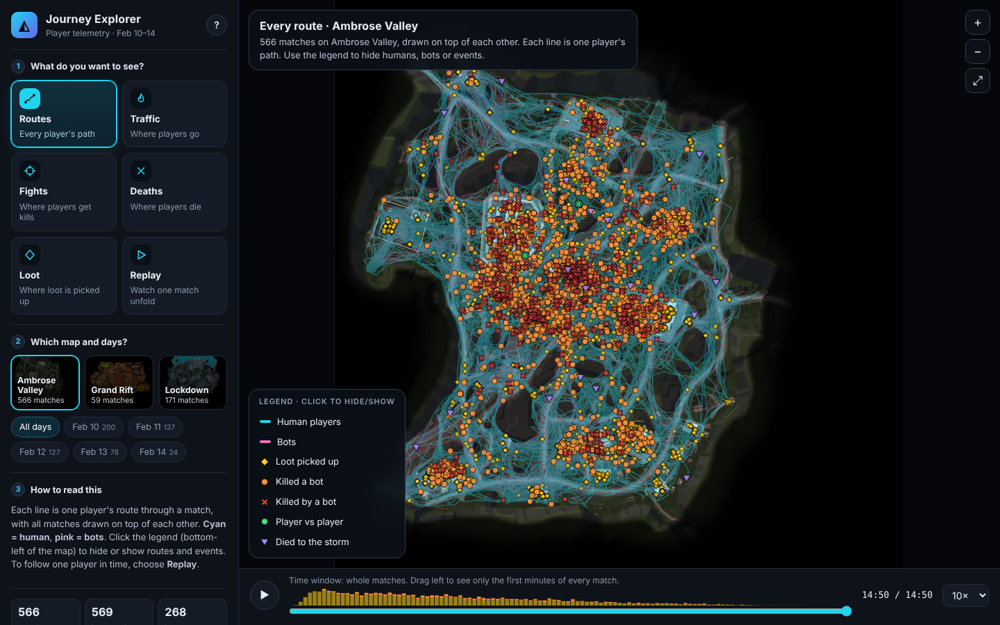
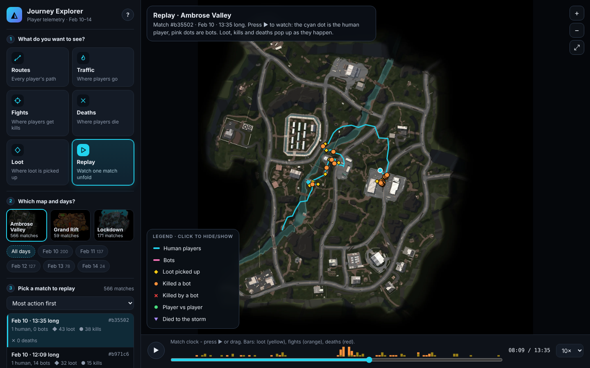
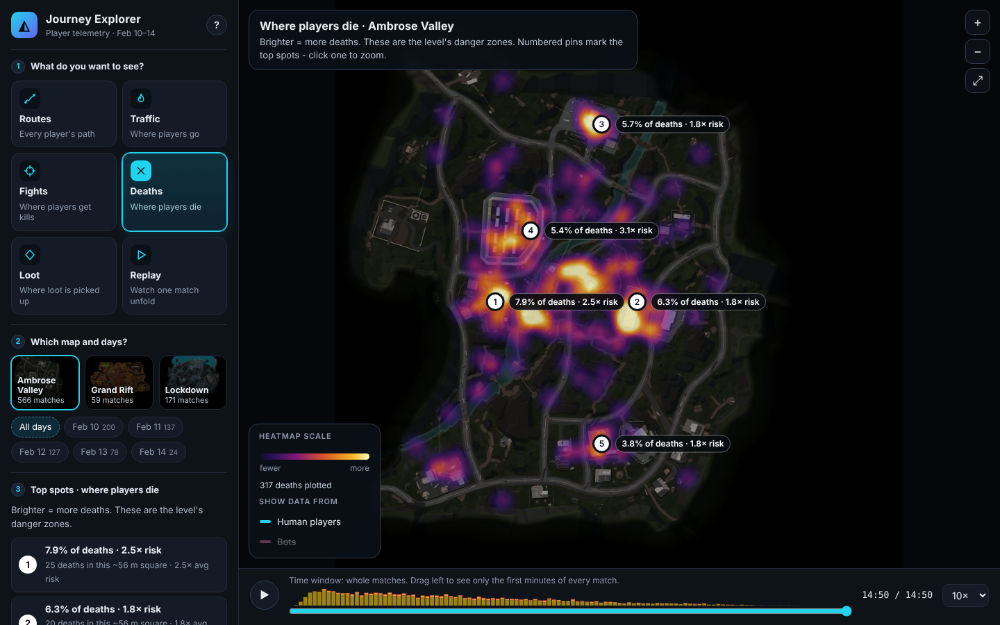

# LILA BLACK · Player Journey Explorer

A browser tool that lets Level Designers see how players actually move, fight, loot and die on the three LILA BLACK maps, built from 5 days of production telemetry (Feb 10-14 2026, 1,243 journeys, 796 matches, 89k events).

**Live URL:** **[https://yeshwanth2812.github.io/lila-journey-explorer/](https://yeshwanth2812.github.io/lila-journey-explorer/)** &nbsp;·&nbsp; Docs: [ARCHITECTURE.md](ARCHITECTURE.md) · [INSIGHTS.md](INSIGHTS.md) · [Plain-language explainer](docs/EXPLAINER.md)



## What you can do (walkthrough)
The sidebar is a short top-to-bottom flow, and every control explains itself:

| Step | What it does |
|---|---|
| **1 · What do you want to see?** | Six big cards, each answering a plain question: **Routes** (every player's path) · **Traffic** (where players go) · **Fights** (where kills happen) · **Deaths** (where players die) · **Loot** (where loot is taken) · **Replay** (watch one match unfold, auto-picks the busiest). |
| **2 · Which map and days?** | Map cards with minimap thumbnails; day chips (multi-select, "All days"). |
| **3 · Context panel** | Changes with the view. For heatmaps: a **ranked list of the top 5 hotspots** (share of the total, plus "× risk" = how much deadlier than average per visit, for deaths). For Replay: a match picker showing humans/bots, loot, kills, deaths. |
| **Numbered pins on the map** | The same top-5 hotspots drawn on the minimap (e.g. "#1 · 7.9% of deaths · 2.5× risk"). **Click a pin or a list item to zoom to it.** Hover any heatmap to read "N deaths in this ~56 m square". |
| **Legend = layer switches** | Bottom-left of the map. Click *Human players, Bots, Loot, Killed a bot, Killed by a bot, Player vs player, Died to the storm* to show/hide them. In heatmap views it becomes a colour scale. Humans are cyan, bots pink. |
| **Timeline / playback** | Bottom bar: ▶ (or `Space`), scrub, ±5 s (`←` `→`), speed 1-60×. The strip shows *when* loot (yellow), fights (orange) and deaths (red) happen. In non-replay views it is a "time window": drag left to see only the first minutes of every match. |
| **Zoom, pan, share** | Wheel to zoom, drag to pan, double-click to reset. The URL stores your view (e.g. `#map=Lockdown&lens=deaths`). The **?** button re-opens the welcome card. |




## Walkthrough video
[`docs/walkthrough.mp4`](docs/walkthrough.mp4) - ~40-second tour of every feature (the six views, hotspot pins, replay, zoom).

## Tech stack
Python 3 (offline pipeline + `analysis/insights.py`; Pillow, optional pyarrow) → static JSON/WebP → vanilla JS ES modules + Canvas 2D. **No backend, no env vars, no build step.**

## Run locally
```bash
python -m http.server 8000 --directory web     # then open http://localhost:8000
```
The generated `web/data/` and `web/maps/` are committed, so this works straight after cloning.

## Rebuild the data (only if the raw data changes)
```bash
pip install -r pipeline/requirements.txt        # pillow (+ pyarrow if you like)
python pipeline/build_data.py --src /path/to/player_data --out web
python pipeline/tests/test_mapping.py           # coordinate-mapping check
```
`--src` is the unzipped `player_data/` folder (with `February_*/` and `minimaps/`).

## Deploy
It is a plain static folder (`web/`), pick any:
- **Netlify**: "Add new site → Import from Git" - `netlify.toml` already sets publish dir `web`. Or drag-drop the `web/` folder.
- **Vercel**: import the repo - `vercel.json` sets the output directory to `web`.
- **GitHub Pages**: Settings → Pages → Source: *GitHub Actions*; `.github/workflows/pages.yml` publishes `web/` on every push to `main`.

## Repo layout
```
web/            index.html, css/, js/ (constants, data, heatmap, viewer, main), data/, maps/
analysis/       insights.py  (reproduces every number in INSIGHTS.md)
pipeline/       build_data.py, miniparquet.py (pure-python reader fallback), tests/
docs/           screenshots
ARCHITECTURE.md  INSIGHTS.md
```
## Known limitations
- Matches contain almost only one human journey, so "match" playback is mostly one player plus bots (data property, see INSIGHTS #1).
- Events on bot-owned files (`BotKill`/`BotKilled`) are drawn at the bot's position; their exact semantics aren't documented in the dataset README.
- `ts` has 1-second resolution, so same-second events can't be ordered finer.
