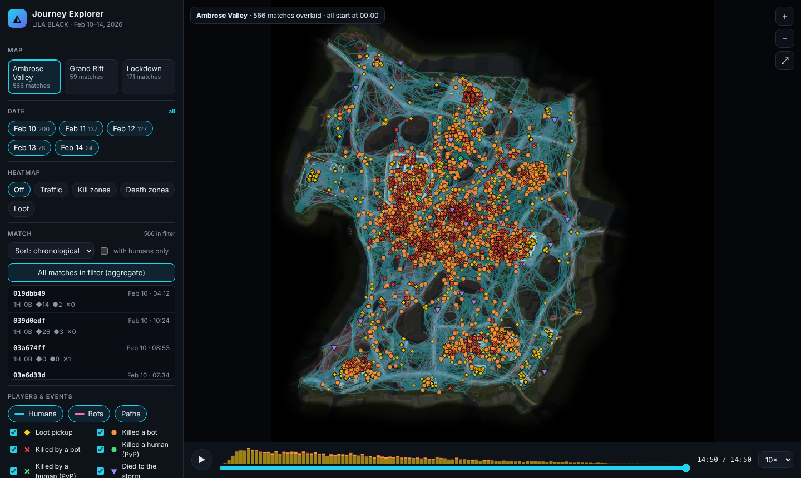
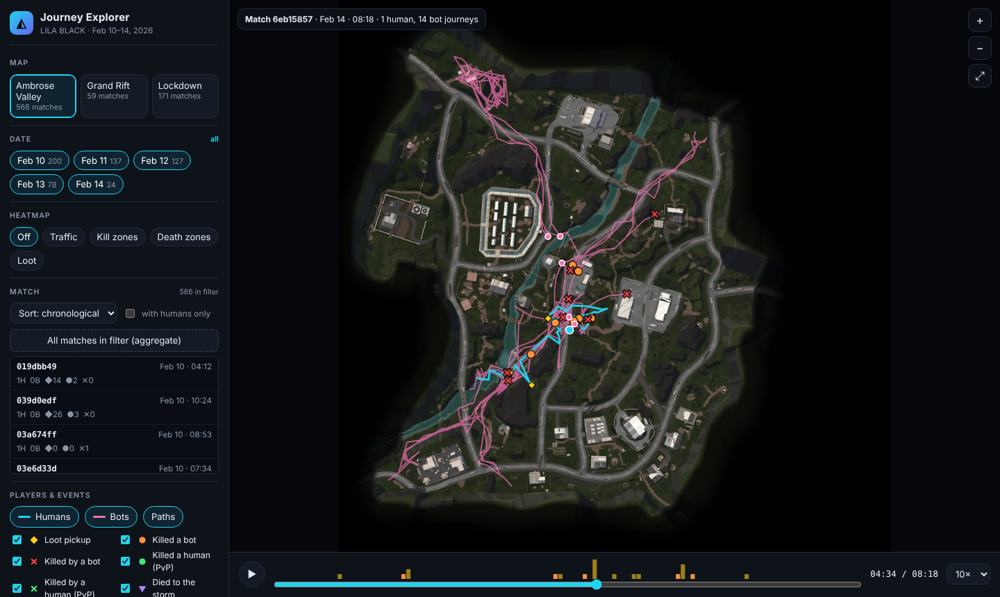
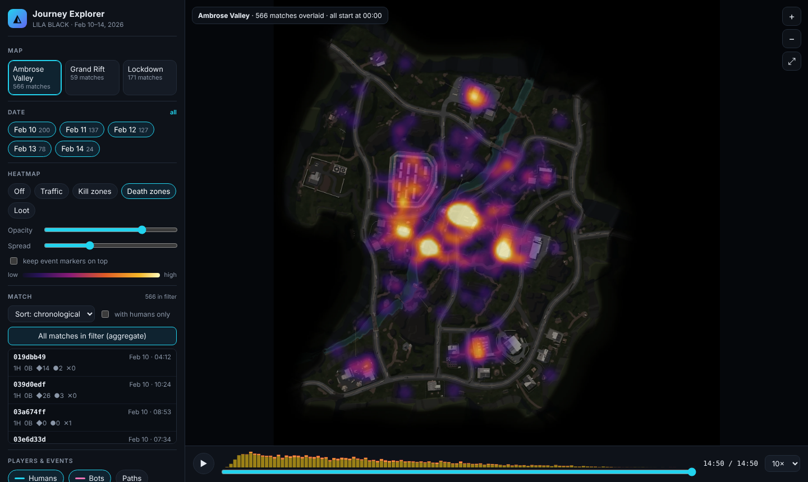

# LILA BLACK · Player Journey Explorer

A browser tool that lets Level Designers see how players actually move, fight, loot and die on the three LILA BLACK maps, built from 5 days of production telemetry (Feb 10-14 2026, 1,243 journeys, 796 matches, 89k events).

**Live URL:** `<paste deployed URL here>` &nbsp;·&nbsp; Docs: [ARCHITECTURE.md](ARCHITECTURE.md) · [INSIGHTS.md](INSIGHTS.md)



## What you can do (walkthrough)
| Feature | How |
|---|---|
| **Pick map / date / match** | Left panel: map cards, date chips (multi-select), match list (sortable by length, kills, deaths, loot; each row shows humans/bots and event counts). "All matches" overlays every match in the filter. |
| **Journeys on the right minimap** | Paths are drawn on the minimap using the README's world→pixel mapping (see ARCHITECTURE.md). **Humans = cyan, thick; bots = pink, thin.** |
| **Event markers** | ◆ loot · ● kill (orange = bot, green = human) · ✕ death (red = bot, green = human) · ▼ storm death. Toggle each; hover for player, match time and world coordinates. |
| **Timeline / playback** | Bottom bar: play/pause (`Space`), scrub, step ±5 s (`←` `→`), speed 1-60×. Paths grow and markers appear as time passes; with one match selected you also see live player dots. The strip above the slider shows *when* loot (yellow), kills (orange) and deaths (red) happen. In aggregate mode all matches are time-aligned to 00:00. |
| **Heatmaps** | Traffic · Kill zones · Death zones · Loot, with opacity and spread sliders. They respect every filter, the human/bot toggles and the time cursor. |
| **Zoom / pan** | Wheel to zoom, drag to pan, double-click to reset. |
| **Shareable views** | The URL hash stores map, dates, match and heatmap, e.g. `#map=Lockdown&heat=deaths`. |




## Tech stack
Python 3 (offline pipeline; Pillow, optional pyarrow) → static JSON/WebP → vanilla JS ES modules + Canvas 2D. **No backend, no env vars, no build step.**

## Run locally
```bash
python -m http.server 8000 --directory web     # then open http://localhost:8000
```
The generated `web/data/` and `web/maps/` are committed, so this works straight after cloning.

## Rebuild the data (only if the raw data changes)
```bash
pip install -r pipeline/requirements.txt        # pillow (+ pyarrow if you like)
python pipeline/build_data.py --src /path/to/player_data --out web
python pipeline/tests/test_mapping.py           # coordinate-mapping check
```
`--src` is the unzipped `player_data/` folder (with `February_*/` and `minimaps/`).

## Deploy
It is a plain static folder (`web/`), pick any:
- **Netlify**: "Add new site → Import from Git" - `netlify.toml` already sets publish dir `web`. Or drag-drop the `web/` folder.
- **Vercel**: import the repo - `vercel.json` sets the output directory to `web`.
- **GitHub Pages**: Settings → Pages → Source: *GitHub Actions*; `.github/workflows/pages.yml` publishes `web/` on every push to `main`.

## Repo layout
```
web/            index.html, css/, js/ (constants, data, heatmap, viewer, main), data/, maps/
pipeline/       build_data.py, miniparquet.py (pure-python reader fallback), tests/
docs/           screenshots
ARCHITECTURE.md  INSIGHTS.md
```
## Known limitations
- Matches contain almost only one human journey, so "match" playback is mostly one player plus bots (data property, see INSIGHTS #1).
- Events on bot-owned files (`BotKill`/`BotKilled`) are drawn at the bot's position; their exact semantics aren't documented in the dataset README.
- `ts` has 1-second resolution, so same-second events can't be ordered finer.
